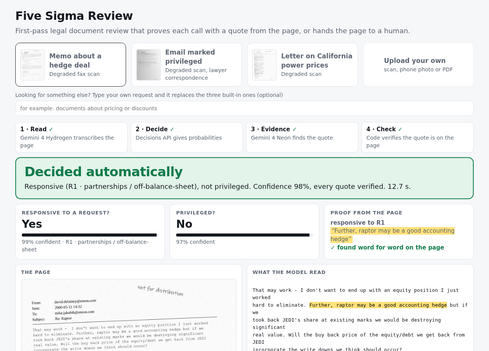
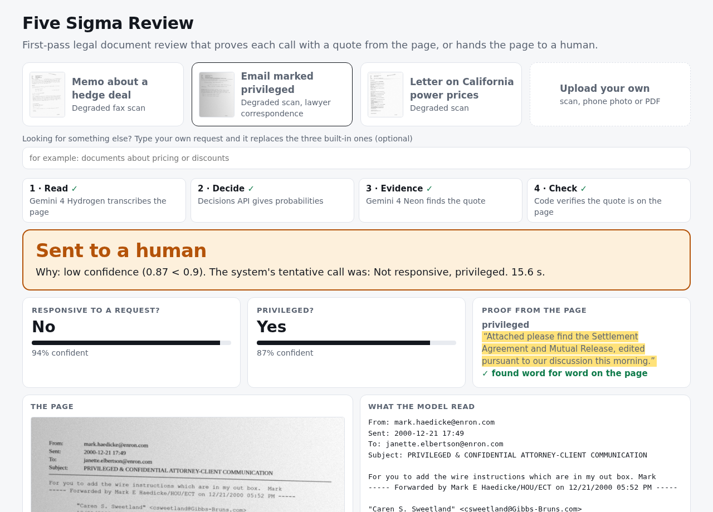
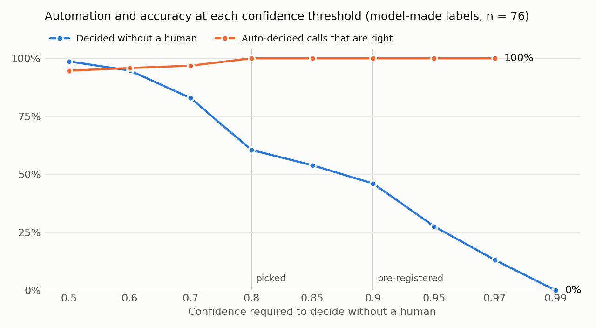

# Five Sigma Review

First-pass legal document review of scanned pages. It says when it is not sure. Built at the Gemini 4 NYC Hackathon (Nov 21, 2026), Problem Statement One. Everything in this repository was written that day; it contains no earlier code.

**Live demo (during judging, Nov 21, 2026):** https://impact-chain-number-cgi.trycloudflare.com
This is a temporary link to the demo running on the presenter's laptop. If it is down, watch the video below or see "Run it".

**Demo video (1 minute):** https://youtu.be/DxOfqChEowc

|  |  |
|---|---|
| **Decided automatically:** confidence clears the 0.9 threshold and the supporting quote is verified verbatim on the page. | **Sent to a human:** privilege confidence (0.87) falls below the 0.9 threshold, so the page is routed for human review with the reason. |

**At a glance** (76 scans; labels made by Gemini 4 models, not by an attorney):

- **Agreement with the labels on all 76:** single-call baseline 64 (84%), Five Sigma 71 (93%), against Argon's model labels. Against a second labeler it is 68 and 71; against a third the baseline is ahead, 69 and 66.
- **Decided alone at threshold 0.9:** 35 of 76. No model labeler disputes the responsiveness or privilege call on any of the 35. One labeler disputes the request tag on two of them.
- **Privilege precision, on Argon's model labels:** baseline 43%, Five Sigma 71%. The baseline over-calls privilege (8 false calls against 2); it also catches one more of the seven privileged documents (6 against 5).
- **Every disagreement with Argon's labels went to a human:** five documents, all below the threshold.

## The problem

In litigation, lawyers code thousands of documents. For each one they decide whether it is responsive to a document request, which request, and whether it is privileged. Models do this fast, but a wrong privilege call that nobody looks at can waive privilege. A reviewer needs to know which calls can be trusted without checking and which cannot.

## What it does

**Scan → Hydrogen (read) → Decisions API (probabilities) → Neon (quote) → code check → decided automatically, or sent to a human.**

The input is one scanned page: a photo, a scan or a PDF. Three Gemini 4 models each do one job, and then code checks their work:

| Stage | Model | Job |
|---|---|---|
| 1. Read | `gemini-4-hydrogen` | Transcribe the page exactly, including stamps and handwriting |
| 2. Decide | Decisions API, `gemini-decision-1` | A probability for each call (responsive, which request, privileged), based on the image and the transcription |
| 3. Evidence | `gemini-4-neon` | For each positive call, the exact quote that supports it |
| 4. Check | plain code | Every quote must appear verbatim in the transcription |

A document is decided automatically only if confidence is at or above a threshold **and** every quote is verified. Anything else goes to a human with the reason. The system fails closed.

**Baseline:** one `gemini-4-hydrogen` call on the same image that answers all three questions at once.

## How it was tested

- **Documents:** 76 public Enron emails (Hugging Face `corbt/enron-emails`), each rendered as a page and degraded by `src/scan.py` (skew, blur, noise, fax header, Bates stamp, margin note in a handwriting font, perspective). The committed scans were rendered with Courier New and Ink Free, which are not included in this repository. Re-running `src/scan.py` without them uses fallback fonts and produces different-looking scans.
- **Requests:** three mock document requests and a privilege rule, in `data/requests.md`.
- **Labels:** made by three model labelers (Argon, Carbon and Neon), each given only the scan and the review instructions. No attorney has labeled the set yet. See Results.
- **Order of events, checkable in the git history:** model outputs for all 76 documents (`eval/results.jsonl`) were committed before the first label was saved. The scorer and the rule for picking a new threshold were also committed before the first label. The threshold in that run was 0.9.
- **Two runs, one scored:** the first run (12:15) used a personal API key instead of the hackathon one. We ran everything again on the hackathon key and committed that run at 12:50. No label existed yet, and we never scored the first run or compared it with the second. Only the second run is scored. The first is in the git history.

### How the test set was chosen: a known limitation

Of the 76 documents, 40 were found by keyword searches for terms that match the requests (for example `LJM`, `Raptor` and `document retention`). The other 36 came from random positions in the corpus. Keyword-picked documents are easier for any model, because the search term is usually what makes them responsive. So results are reported three ways: all documents, random only, and keyword-picked only. The random group is the fairer estimate.

**Duplicates, found after scoring.** The corpus stores the same email in several mailboxes. Of the 76 test documents, 15 repeat the text of another one, all among the keyword-picked documents. So the set holds 61 distinct emails. Each copy is a different degraded scan, but the copies are not independent tests. The results table has a row that counts each distinct email once.

## Results

The table uses Argon's labels, so "right" means "agrees with Argon". Carbon's labels are scored in `eval/REPORT_carbon.md` and compared below.

Threshold 0.9, fixed before any label existed:

| Documents | n | Single-call baseline right | Five Sigma right (all documents) | Five Sigma right (auto-decided only) | Decided without a human | Wrong but auto-decided |
|---|---|---|---|---|---|---|
| All | 76 | 64/76 (84%) | 71/76 (93%) | 35/35 (100%) | 35/76 (46%) | 0 |
| Random | 36 | 35/36 (97%) | 34/36 (94%) | 21/21 (100%) | 21/36 (58%) | 0 |
| Keyword-picked | 40 | 29/40 (72%) | 37/40 (92%) | 14/14 (100%) | 14/40 (35%) | 0 |
| Distinct emails only | 61 | 53/61 (87%) | 58/61 (95%) | 30/30 (100%) | 30/61 (49%) | 0 |

**The labels are models', not an attorney's.** Two models first labeled all 76 scans independently: Gemini 4 Argon through the API (`src/model_label.py`) and Gemini 4 Carbon through the labeling page. Each saw only the scan and the review instructions. They agree on 72 of 76. The four differences are all privilege calls (DOC-040, DOC-051, DOC-055, DOC-072). A third model labeler, Gemini 4 Neon, was added later; see below.

95% intervals on all documents: baseline 74% to 91%, Five Sigma on everything 86% to 97%, Five Sigma on what it decided alone 90% to 100%. The sample is small, so a difference of a few documents could be chance.

What the numbers say:

- **No document it decided alone has a responsiveness or privilege call that any labeler disputes.** The system decided 35 documents on its own. Argon, Carbon and the three-labeler majority match it on all 35. Neon matches its responsiveness and privilege calls on all 35 but gives a different request tag on two: DOC-062 and DOC-071, two copies of one email about collecting files for the LJM litigation. The system tagged them R1 (LJM) and Neon tagged them R3 (document handling). The system disagreed with Argon on five documents and sent all five to a human.
- **Its edge is routing, not raw agreement.** On the 61 distinct emails the system matches Argon on 58 and the baseline on 53. Against Carbon it is 56 against 55. Against Neon the baseline is ahead, 56 against 53.
- **The price is review.** It sent 41 documents to a human, and it had 36 of those right anyway.
- **The baseline over-calls privilege.** Of its 12 disagreements, 8 are documents it called privileged and the labels did not. Privilege precision: baseline 43%, Five Sigma 71%.
- **On random documents the system is no better than the baseline** (34 of 36 against 35 of 36). The gain is on keyword-picked documents (37 of 40 against 29 of 40), where the privileged-looking documents are.

Full detail is in `eval/REPORT_argon.md`.

A third model labeler, Gemini 4 Neon (`eval/labels_neon.json`), was added later under the same scan-only prompt (`eval/AGREEMENT.md`). Agreement on all three calls across the 76 scans:

- Argon and Carbon: 72/76 (95%)
- Carbon and Neon: 71/76 (93%)
- Argon and Neon: 67/76 (88%)
- All three unanimous: 67/76

Neon is also the model that finds supporting quotes inside Stage 3 of the system, so it is less independent than Argon and Carbon.

We also ran a synthetic second-look check: one model, given extra guidance (`data/privilege_guidance.md`), relabeled 25 scans. The 25 are the 15 where the system or the baseline disagreed with Argon's labels, plus 10 random controls (`eval/labels_synthetic25.json`, reported in `eval/AGREEMENT.md`). It matches the three-labeler majority on 19 of the 25 and sides with Neon on the request tag (`R3` instead of `R1`) of DOC-062 and DOC-071. Its guidance told it to weigh R1 against R3 on exactly this kind of document, so that is not independent confirmation. Those 25 labels are still synthetic model output, not attorney review.

### Full reports

| File | What it shows |
|---|---|
| [eval/REPORT_argon.md](eval/REPORT_argon.md), [eval/REPORT_carbon.md](eval/REPORT_carbon.md) | System and baseline against each labeler: precision, recall, head to head, and which documents went wrong |
| [eval/THRESHOLDS_argon.md](eval/THRESHOLDS_argon.md), [eval/THRESHOLDS_carbon.md](eval/THRESHOLDS_carbon.md) | Every threshold from 0.5 to 0.99: how many documents were decided, how many wrong, with and without the quote check |
| [eval/CALIBRATION_argon.md](eval/CALIBRATION_argon.md), [eval/CALIBRATION_carbon.md](eval/CALIBRATION_carbon.md) | Agreement by confidence band |
| [eval/AGREEMENT.md](eval/AGREEMENT.md) | The three labelers against each other, the nine documents they split on, the majority label, and the synthetic check |
| [eval/threshold_curve_argon.png](eval/threshold_curve_argon.png), [eval/threshold_curve_carbon.png](eval/threshold_curve_carbon.png) | The threshold chart |

Every report opens by saying whose labels it uses. All labels are model-made.

## What we changed after seeing failures

Against Argon's and Carbon's labels no wrong call got through at 0.9. The failure we saw first was cost: more than half the documents went to a human, most of them needlessly. So we lowered the threshold, by the rule fixed in advance in `src/sweep.py`:

1. Replay the stored outputs at other thresholds, with no new model calls.
2. Pick the lowest threshold with no wrong auto-decision on DOC-001 to DOC-050. That threshold is 0.8.
3. Report 0.8 on DOC-051 onward. Those documents play no part in the choice.

| | Decided without a human | Wrong but auto-decided |
|---|---|---|
| DOC-001 to 050, threshold 0.9 | 23/50 (46%) | 0 |
| DOC-001 to 050, threshold 0.8 | 31/50 (62%) | 0 |
| DOC-051 to 076, threshold 0.9 | 12/26 (46%) | 0 |
| DOC-051 to 076, threshold 0.8 | 15/26 (58%) | 0 |

On the 26 documents that the choice never used, 0.8 decides three more documents and still lets nothing wrong through. Six of those 26 repeat the text of a tuning document, so they are not a clean test. On the 20 that do not, 0.8 decides 12 where 0.9 decided 9, also with nothing wrong. Below 0.8 wrong calls start to get through: one at 0.7 in each group. Carbon's labels pick the same threshold and give the same counts.



The quote check added little on this set. At 0.9 one document failed the quote check, but its confidence was already below the threshold, so the check changed no decision there. In the replay, dropping the check changes the outcome only at a threshold of 0.5, where it stops one wrong call. Every threshold is in `eval/THRESHOLDS_argon.md`.

## Does the confidence mean anything?

On this small sample, yes: agreement with the labels rises with the system's confidence. Every document with confidence of 0.8 or more matches the labels (46 of 46), and all five disagreements sit below 0.8. Carbon's labels give the same counts in every row. The bins are small, 76 documents and 61 distinct emails, so one or two documents can move a row a long way. This shows the confidence ranks documents sensibly here; it does not show that a stated 0.9 means 90% right.

| System confidence | Documents | All three calls match Argon's labels |
|---|---|---|
| below 0.7 | 13 | 10/13 (77%) |
| 0.7 to 0.8 | 17 | 15/17 (88%) |
| 0.8 to 0.9 | 11 | 11/11 (100%) |
| 0.9 to 0.95 | 14 | 14/14 (100%) |
| 0.95 and above | 21 | 21/21 (100%) |

The same breakdown for each probability on its own is in `eval/CALIBRATION_argon.md` and `eval/CALIBRATION_carbon.md`.

## Where it still fails

- **Privilege is the weak point.** Four of the five disagreements are privilege calls. In two the system missed privilege that the labeler found (DOC-010, DOC-040). In two it called privilege that the labeler did not (DOC-023, DOC-072). Its confidence on all four was between 0.51 and 0.80, so all four went to a human.
- **One responsiveness miss.** DOC-058 is an automated transmission notice that the labeler tied to the California market and the system did not.
- **A request tag got through unreviewed, and the gate does not cover it.** DOC-062 and DOC-071 (one email, two copies) were decided automatically as R1. Neon calls them R3; Argon and Carbon agree with R1. Nobody disputes that they are responsive and not privileged. But the confidence that gates automatic decisions covers only the responsive and privileged probabilities, not which request. The Decisions API gave R1 a probability of 0.67 and 0.79 on these two. In a replay, also requiring the request probability to be at least 0.8 sends both to a human and leaves 33 automatic decisions at 0.9 (43 at 0.8) with no disagreement against any labeler. We found this after the third labeler was added. The cut-off of 0.8 was chosen on these same documents and the change is not in the shipped pipeline, so treat it as the next change, not a result.
- **It decides less than half the documents alone at 0.9** (35 of 76), and 61% at 0.8 (46 of 76).
- **The labels are models'.** Argon and Carbon disagree with each other on four privilege calls (as many as the system's own privilege disagreements), and across all three labelers 9 of 76 documents split. Argon marked 19 of the 76 as documents a careful reviewer could disagree on. The system sent 16 of those 19 to a human, which suggests it is unsure about the right documents, but no attorney has checked the labels.

Limits of the test itself:

- The scans are synthetic. Real paper scans and real handwriting will be harder.
- The sample is small: 61 distinct emails. Differences of a few documents could be chance.
- Each document is one page, and all are short emails (250 to 2,200 characters).
- The Enron corpus is public and widely used, so the models may have seen these emails in training.
- The labeler, like the baseline, is one model reading the page. That may favor the baseline.
- The quote check proves the quote is on the page as transcribed. It does not prove the quote supports the call, and it cannot catch a transcription error that the quote repeats.

## Provenance

- **Built on hackathon day:** everything in this repository was written on Nov 21, 2026 at the Gemini 4 NYC Hackathon (Problem Statement One), from the first commit to the final commit in `git log`.
- **Public data only:** source emails come from `corbt/enron-emails` on Hugging Face; synthetic scan rendering and degradation are in `src/scan.py`.
- **Pre-committed predictions:** `eval/results.jsonl` and `src/sweep.py` were committed before any label file existed (checkable via `git log --reverse`).
- **Disclosed model labels:** every label file (`eval/labels_argon.json`, `eval/labels_carbon.json`, `eval/labels_neon.json`, `eval/labels_synthetic25.json`) is a Gemini 4 model output, never presented as human attorney review.

## Run it

```
pip install -r requirements.txt
echo "GEMINI_API_KEY=..." > .env          # or .env.hackathon; both are gitignored
python3 src/app.py                        # live demo: http://127.0.0.1:8801
python3 src/run_eval.py                   # system and baseline on every scan -> eval/results.jsonl
python3 src/label_app.py                  # attorney labeling page: http://127.0.0.1:8800 -> eval/labels.json
python3 src/model_label.py gemini-4-argon argon   # model labeler -> eval/labels_argon.json
LABELS_FILE=labels_argon.json python3 src/score.py   # -> eval/REPORT_argon.md (without LABELS_FILE: attorney labels -> eval/REPORT.md)
LABELS_FILE=labels_argon.json python3 src/sweep.py   # -> eval/THRESHOLDS_argon.md, eval/threshold_curve_argon.png
LABELS_FILE=labels_argon.json python3 src/calibration.py   # -> eval/CALIBRATION_argon.md
```

The live demo differs from the scored run in three ways. None of them affects the evaluation:

- It normalizes uploads first (rotates phone photos upright and shrinks them to 2,200 pixels on the long side).
- Its three sample scans (`data/samples/`) are public Enron emails that are not among the 76 test documents.
- It has an optional box for typing your own request, which replaces the three built-in ones for that page. The evaluation used only the built-in requests.

Public data only. Not legal advice.
