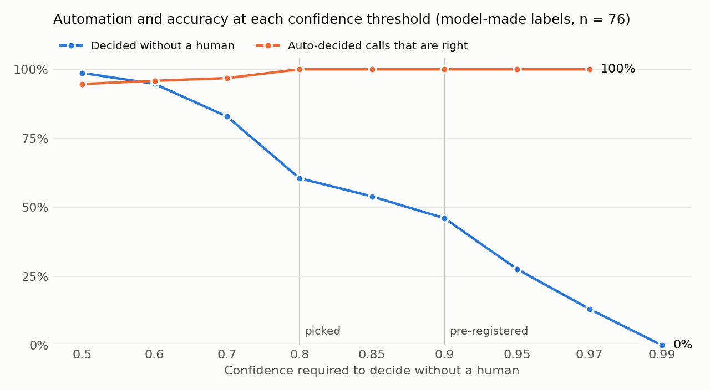

# What we changed after seeing failures: the auto-decision threshold

**Scored against labels made by a model (Gemini 4 Argon), not by the attorney. "Right" and "wrong" here mean agreement or disagreement with that model.**

The system was run once, with the threshold fixed at 0.9 before any label existed. After scoring, we replayed the stored outputs at other thresholds (no new model calls). A document is decided without a human only if its confidence is at or above the threshold AND every supporting quote is found verbatim on the page; the last column drops the quote check to show what that check adds.

To avoid tuning on the test set, the threshold was picked on DOC-001..050 only, by this rule: the lowest threshold with no wrong auto-decision. It was then checked on DOC-051 onward, which the choice never saw.

**Picked threshold: 0.8** (was 0.9).

| | Decided without a human | Wrong but auto-decided |
|---|---|---|
| Tuning documents, before (0.9) | 23/50 (46%) | 0 |
| Tuning documents, after (0.8) | 31/50 (62%) | 0 |
| Confirmation documents, before (0.9) | 12/26 (46%) | 0  |
| Confirmation documents, after (0.8) | 15/26 (58%) | 0  |

### Tuning documents (n = 50)

| Threshold | Decided without a human | Auto-decided and right | Wrong but auto-decided | Same, without the quote check |
|---|---|---|---|---|
| 0.5 | 49/50 (98%) | 47/49 (96%) | 2 ['DOC-010', 'DOC-040'] | 50/50 (100%) decided, 3 wrong |
| 0.6 | 49/50 (98%) | 47/49 (96%) | 2 ['DOC-010', 'DOC-040'] | 49/50 (98%) decided, 2 wrong |
| 0.7 | 44/50 (88%) | 43/44 (98%) | 1 ['DOC-010'] | 44/50 (88%) decided, 1 wrong |
| 0.8 (picked) | 31/50 (62%) | 31/31 (100%) | 0  | 31/50 (62%) decided, 0 wrong |
| 0.85 | 27/50 (54%) | 27/27 (100%) | 0  | 27/50 (54%) decided, 0 wrong |
| 0.9 (pre-registered) | 23/50 (46%) | 23/23 (100%) | 0  | 23/50 (46%) decided, 0 wrong |
| 0.95 | 13/50 (26%) | 13/13 (100%) | 0  | 13/50 (26%) decided, 0 wrong |
| 0.97 | 6/50 (12%) | 6/6 (100%) | 0  | 6/50 (12%) decided, 0 wrong |
| 0.99 | 0/50 (0%) | 0/0 | 0  | 0/50 (0%) decided, 0 wrong |

### Confirmation documents (never used to pick) (n = 26)

| Threshold | Decided without a human | Auto-decided and right | Wrong but auto-decided | Same, without the quote check |
|---|---|---|---|---|
| 0.5 | 26/26 (100%) | 24/26 (92%) | 2 ['DOC-058', 'DOC-072'] | 26/26 (100%) decided, 2 wrong |
| 0.6 | 23/26 (88%) | 22/23 (96%) | 1 ['DOC-058'] | 23/26 (88%) decided, 1 wrong |
| 0.7 | 19/26 (73%) | 18/19 (95%) | 1 ['DOC-058'] | 19/26 (73%) decided, 1 wrong |
| 0.8 (picked) | 15/26 (58%) | 15/15 (100%) | 0  | 15/26 (58%) decided, 0 wrong |
| 0.85 | 14/26 (54%) | 14/14 (100%) | 0  | 14/26 (54%) decided, 0 wrong |
| 0.9 (pre-registered) | 12/26 (46%) | 12/12 (100%) | 0  | 12/26 (46%) decided, 0 wrong |
| 0.95 | 8/26 (31%) | 8/8 (100%) | 0  | 8/26 (31%) decided, 0 wrong |
| 0.97 | 4/26 (15%) | 4/4 (100%) | 0  | 4/26 (15%) decided, 0 wrong |
| 0.99 | 0/26 (0%) | 0/0 | 0  | 0/26 (0%) decided, 0 wrong |

### All labeled, random documents only (n = 36)

| Threshold | Decided without a human | Auto-decided and right | Wrong but auto-decided | Same, without the quote check |
|---|---|---|---|---|
| 0.5 | 35/36 (97%) | 34/35 (97%) | 1 ['DOC-058'] | 36/36 (100%) decided, 2 wrong |
| 0.6 | 35/36 (97%) | 34/35 (97%) | 1 ['DOC-058'] | 35/36 (97%) decided, 1 wrong |
| 0.7 | 33/36 (92%) | 32/33 (97%) | 1 ['DOC-058'] | 33/36 (92%) decided, 1 wrong |
| 0.8 (picked) | 27/36 (75%) | 27/27 (100%) | 0  | 27/36 (75%) decided, 0 wrong |
| 0.85 | 25/36 (69%) | 25/25 (100%) | 0  | 25/36 (69%) decided, 0 wrong |
| 0.9 (pre-registered) | 21/36 (58%) | 21/21 (100%) | 0  | 21/36 (58%) decided, 0 wrong |
| 0.95 | 13/36 (36%) | 13/13 (100%) | 0  | 13/36 (36%) decided, 0 wrong |
| 0.97 | 6/36 (17%) | 6/6 (100%) | 0  | 6/36 (17%) decided, 0 wrong |
| 0.99 | 0/36 (0%) | 0/0 | 0  | 0/36 (0%) decided, 0 wrong |

### All labeled, keyword-picked documents only (n = 40)

| Threshold | Decided without a human | Auto-decided and right | Wrong but auto-decided | Same, without the quote check |
|---|---|---|---|---|
| 0.5 | 40/40 (100%) | 37/40 (92%) | 3 ['DOC-010', 'DOC-040', 'DOC-072'] | 40/40 (100%) decided, 3 wrong |
| 0.6 | 37/40 (92%) | 35/37 (95%) | 2 ['DOC-010', 'DOC-040'] | 37/40 (92%) decided, 2 wrong |
| 0.7 | 30/40 (75%) | 29/30 (97%) | 1 ['DOC-010'] | 30/40 (75%) decided, 1 wrong |
| 0.8 (picked) | 19/40 (48%) | 19/19 (100%) | 0  | 19/40 (48%) decided, 0 wrong |
| 0.85 | 16/40 (40%) | 16/16 (100%) | 0  | 16/40 (40%) decided, 0 wrong |
| 0.9 (pre-registered) | 14/40 (35%) | 14/14 (100%) | 0  | 14/40 (35%) decided, 0 wrong |
| 0.95 | 8/40 (20%) | 8/8 (100%) | 0  | 8/40 (20%) decided, 0 wrong |
| 0.97 | 4/40 (10%) | 4/4 (100%) | 0  | 4/40 (10%) decided, 0 wrong |
| 0.99 | 0/40 (0%) | 0/0 | 0  | 0/40 (0%) decided, 0 wrong |
